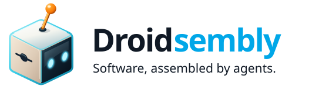
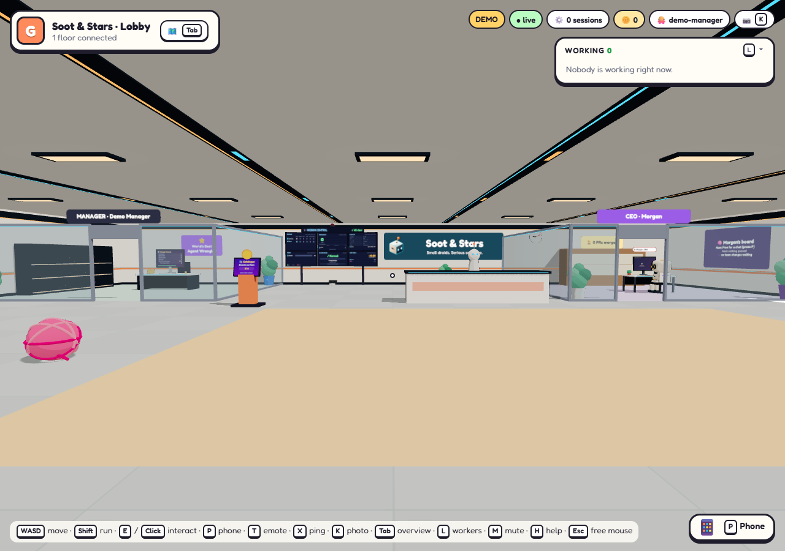
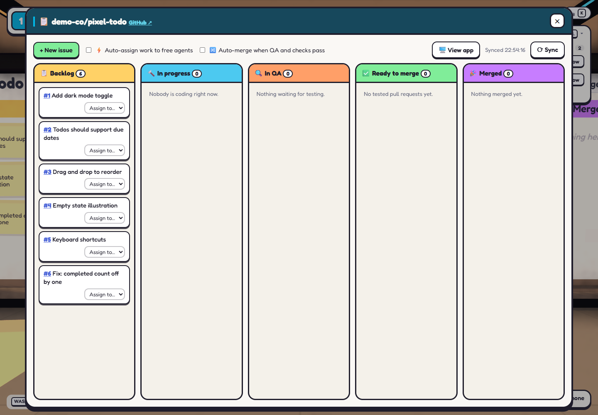
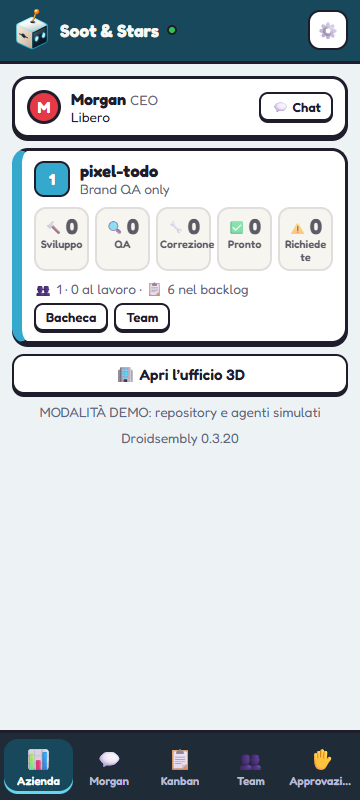

# Droidsembly

<p align="center">
  
</p>

**Small droids. Serious software.**

Uno spazio visuale per lo sviluppo software assistito dall'AI: collega i tuoi repository GitHub, coordina gli agenti di coding e segui il lavoro in un ufficio 3D interattivo o in una dashboard adatta al telefono.

[English](README.md) · **Italiano**

[Codice sorgente](https://github.com/rosariomoscato/droidsembly) · [Segnala un problema](https://github.com/rosariomoscato/droidsembly/issues) · [Documentazione](#documentazione) · [Sostieni il progetto](#sostieni-il-progetto)

**Sito in arrivo:** `droidsembly.com`. Fino alla sua apertura, questo repository è il riferimento per installazione e documentazione.

**Gratuito e open source, con licenza MIT.** Nessuna attivazione a pagamento o sblocco commerciale degli agenti. Il sostegno volontario aiuta lo sviluppo; abbonamenti AI, consumi API e servizi cloud opzionali hanno costi e limiti propri.

## Guarda l'ufficio



<details>
<summary>Kanban e vista mobile Pocket</summary>





</details>

Sono catture demo già disponibili nel fork. Alcuni dettagli grafici precedono gli ultimi aggiornamenti dei popup; nomi di aziende e progetti sono contenuti dimostrativi.

## Cosa puoi fare

- **Coordinare agenti di coding:** Claude Code, Codex e OpenCode V2, con selezione dei modelli e delle varianti di ragionamento supportate. La disponibilità dipende dal runtime: Agent SDK resta esclusivamente Claude e OpenCode è attualmente solo locale.
- **Seguire il workflow completo:** issue → sviluppo e controlli iniziali → pull request → sessione QA separata → correzioni → merge quando le condizioni configurate sono soddisfatte.
- **Mantenere il controllo:** assegnazione manuale o automatica, onboarding CEO facoltativo, approvazione dei cambi team e interruttore distinto per il merge automatico.
- **Osservare il lavoro reale:** terminali live, piani dei progetti, Kanban e console del manager. Clone e worktree locali separano le copie di lavoro degli agenti; non sono sandbox di sicurezza.
- **Consultare l'utilizzo AI:** osservazioni multi-provider, token/costi comunicati e limiti selettivi dello scheduler. I dati mancanti restano non disponibili, non zero o illimitati. Vedi [Utilizzo AI](docs/AI_USAGE.md).
- **Chiedere analisi in sola lettura:** avvia una conversazione senza issue o PR. Le regole di sola lettura sono istruzioni all'agente, non una sandbox.
- **Usare desktop e mobile:** ufficio 3D e vista Pocket touch, interfaccia inglese/italiana, comandi da tastiera e impostazioni di accessibilità. Vedi [copertura delle lingue](docs/languages.md).
- **Personalizzare l'ufficio:** agenti robot, cane robot, decorazioni, musica adattiva, modalità foto e time-lapse.

## Installa questo fork

**Distribuzione attuale: compilazione dai sorgenti.** Le aggiunte del fork non sono pubblicate in un pacchetto npm dedicato o in un installer desktop. `npx cubefarm` installa il pacchetto originale, non Droidsembly. In questo checkout il nome tecnico del pacchetto/CLI resta `cubefarm`; la versione attuale è `0.3.20`.

### Requisiti

- [Node.js](https://nodejs.org/) **22 o successivo**, con npm, e [Git](https://git-scm.com/).
- Per lavoro reale: [GitHub CLI](https://cli.github.com/), autenticato con `gh auth login`, e un coding agent supportato con accesso al proprio provider.
- Claude Code è incluso tramite Agent SDK. OpenCode **2.x** e Codex si installano separatamente quando selezionati. Le sessioni terminale esclusivamente OpenCode non richiedono un abbonamento Claude.
- Google Chrome per gli agenti che verificano i progetti nel browser.

Il progetto è destinato a Windows, macOS e Linux. La demo senza AI descritta sotto non richiede credenziali dei provider o login GitHub.

### 1. Scarica e compila

Esegui questi comandi nella cartella che dovrà contenere un **nuovo** checkout.

**Windows — PowerShell**

```powershell
git clone https://github.com/rosariomoscato/droidsembly.git
cd droidsembly
npm.cmd ci
npm.cmd run build
```

**macOS / Linux**

```bash
git clone https://github.com/rosariomoscato/droidsembly.git
cd droidsembly
npm ci
npm run build
```

### 2. Prova la demo senza AI

Dal checkout, avvia il server compilato con cartella dati e porte dedicate:

**Windows — PowerShell**

```powershell
$env:SWARM_HOME = Join-Path $env:LOCALAPPDATA 'Droidsembly-Demo'
$env:SWARM_PORT = '4419'
$env:SWARM_HOST = '127.0.0.1'
$env:SWARM_PREVIEW_PORT = '9600'
$env:SWARM_DEMO = '1'
node dist-server/index.js --demo
```

**macOS / Linux**

```bash
SWARM_HOME="$HOME/.droidsembly-demo" SWARM_PORT=4419 SWARM_HOST=127.0.0.1 SWARM_PREVIEW_PORT=9600 SWARM_DEMO=1 node dist-server/index.js --demo
```

Apri **http://127.0.0.1:4419/** e verifica che sia indicata la **MODALITÀ DEMO**. GitHub e agenti sono simulati; lo stato demo viene salvato soltanto nella cartella demo scelta. Ferma il server con `Ctrl+C`. Scegli porte libere se queste sono occupate.

### 3. Avvia un ufficio reale

Ferma prima la demo. Usa una cartella dati distinta e rimuovi `--demo`. Le sessioni reali possono modificare i progetti collegati e consumare quota AI.

**Windows — PowerShell**

```powershell
$env:SWARM_HOME = Join-Path $env:LOCALAPPDATA 'Droidsembly'
$env:SWARM_PORT = '4419'
$env:SWARM_HOST = '127.0.0.1'
$env:SWARM_PREVIEW_PORT = '9600'
$env:SWARM_DEMO = '0'
node dist-server/index.js
```

**macOS / Linux**

```bash
SWARM_HOME="$HOME/.droidsembly" SWARM_PORT=4419 SWARM_HOST=127.0.0.1 SWARM_PREVIEW_PORT=9600 SWARM_DEMO=0 node dist-server/index.js
```

Apri **http://127.0.0.1:4419/**. Le cartelle degli esempi sono una scelta esplicita per una nuova installazione, non una migrazione: percorsi dati e launcher esistenti restano validi. Senza `SWARM_HOME`, il percorso predefinito dell'app rimane `~/.cubefarm`.

Prima di collegare un progetto, seleziona il coding agent del CEO se non vuoi usare il predefinito Claude Code. Per saltare l'analisi AI iniziale, disattiva l'opzione che permette al CEO di studiare il repository e pianificare dal brief. Assegnazione automatica, merge automatico e revisioni periodiche CEO sono impostazioni distinte. Vedi [Agenti](docs/agents.md) per configurazione dei provider e limiti dei runtime.

## Desktop, mobile e PWA

Il backend Node.js gira sul computer; il browser visualizza e controlla l'ufficio. Installare la PWA aggiunge l'interfaccia alla schermata iniziale, **ma non installa il backend Node.js o i coding agent**. Il computer dell'ufficio deve restare acceso e raggiungibile.

Per installazione mobile e accesso remoto privato, segui [Pocket](docs/pocket.md) e [Accesso da telefono](docs/phone-access.md). Le funzioni PWA richiedono un browser compatibile e un contesto sicuro, come HTTPS o localhost. L'ufficio non ha un login integrato: mantienilo su loopback oppure usa un accesso privato autenticato, anziché esporlo pubblicamente.

### Comandi essenziali

| Comando | Azione |
| --- | --- |
| `W A S D` / frecce | Cammina |
| `Shift` | Corri |
| `E` / clic sinistro | Interagisci |
| `P` | Apri il telefono |
| `Tab` | Panoramica dell'ufficio |
| `K` | Modalità foto |
| `M` | Silenzia |
| `H` | Guida e lista completa dei comandi |
| `Esc` | Libera il mouse / chiudi un pannello |

Le impostazioni comprendono sottotitoli, comfort di movimento, scala UI, contrasto e viste a elenco. Pocket offre navigazione adatta al touch.

## Aggiornamenti

Per un'installazione dai sorgenti, ferma l'ufficio quando gli agenti sono inattivi, salva un backup dello `SWARM_HOME` scelto e consulta il [changelog del fork](docs/FORK_CHANGELOG.md). In un checkout pulito su `main`, esegui `git pull --ff-only`, poi `npm.cmd ci` e `npm.cmd run build` su Windows (`npm ci` e `npm run build` su macOS/Linux). Riavvia con la stessa cartella dati e le stesse porte. Preserva eventuali modifiche locali prima di aggiornare.

Non usare `npx cubefarm@latest` per aggiornare questo fork: punta al pacchetto npm originale. La CLI ereditata controlla ancora gli aggiornamenti di quel pacchetto. I comandi diretti del server qui indicati non usano il launcher autoaggiornante del checkout; vedi [come funzionano gli aggiornamenti](docs/how-it-works.md#updating-the-office) per quel flusso distinto.

## Sostieni il progetto

Droidsembly è gratuito e open source. Se ti è utile, puoi sostenerne lo sviluppo lasciando una stella al repository, condividendolo, segnalando problemi riproducibili o contribuendo con miglioramenti.

**È previsto il sostegno economico volontario tramite GitHub Sponsors.** Il profilo non è ancora attivo; il link verrà aggiunto quando disponibile. Nessuna donazione è necessaria per usare l'app o sbloccare gli agenti. Restano applicabili i limiti tecnici e le quote dei provider AI.

## Documentazione

- [Agenti e configurazione dei provider](docs/agents.md)
- [Workflow, terminali, QA e aggiornamenti](docs/how-it-works.md)
- [Utilizzo AI multi-provider](docs/AI_USAGE.md) (italiano)
- [Pocket, PWA e notifiche](docs/pocket.md) · [Accesso da telefono](docs/phone-access.md)
- [Agenti cloud opzionali](docs/cloud.md) · [Voce](docs/voice.md)
- [Copertura inglese/italiano](docs/languages.md)
- [Contributi e sviluppo](CONTRIBUTING.md)
- [Changelog del fork](docs/FORK_CHANGELOG.md) (italiano)
- [Report delle verifiche locali](docs/validation-english-italian.md) · [Indagine sul pathfinding](docs/pathfinding-investigation.md)

Parte delle guide tecniche è in inglese. I risultati CI e i fallimenti storici locali sono evidenze distinte: una CI verde non dimostra che quei fallimenti locali siano risolti.

## Crediti e licenza

Droidsembly è mantenuto da [Rosario Moscato](https://github.com/rosariomoscato), a partire da [CubeFarm di Leon van Zyl](https://github.com/leonvanzyl/cubefarm). Questo fork era precedentemente ospitato su `rosariomoscato/cubefarm`.

Il fork aggiunge integrazione OpenCode V2, selezione di modelli/varianti, onboarding facoltativo e analisi manuale, supporto inglese/italiano, grafica robotica e identità visiva, stile coordinato desktop/mobile, musica adattiva e monitoraggio dell'utilizzo multi-provider. Il [changelog](docs/FORK_CHANGELOG.md) documenta implementazioni e verifiche.

Distribuito con licenza [MIT](LICENSE), conservando l'avviso originale **Copyright (c) 2026 Leon van Zyl**. I componenti di terze parti mantengono le rispettive licenze, inclusa la [SIL Open Font License del font Sora](client/public/icons/Sora-OFL.txt).
